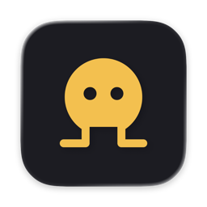
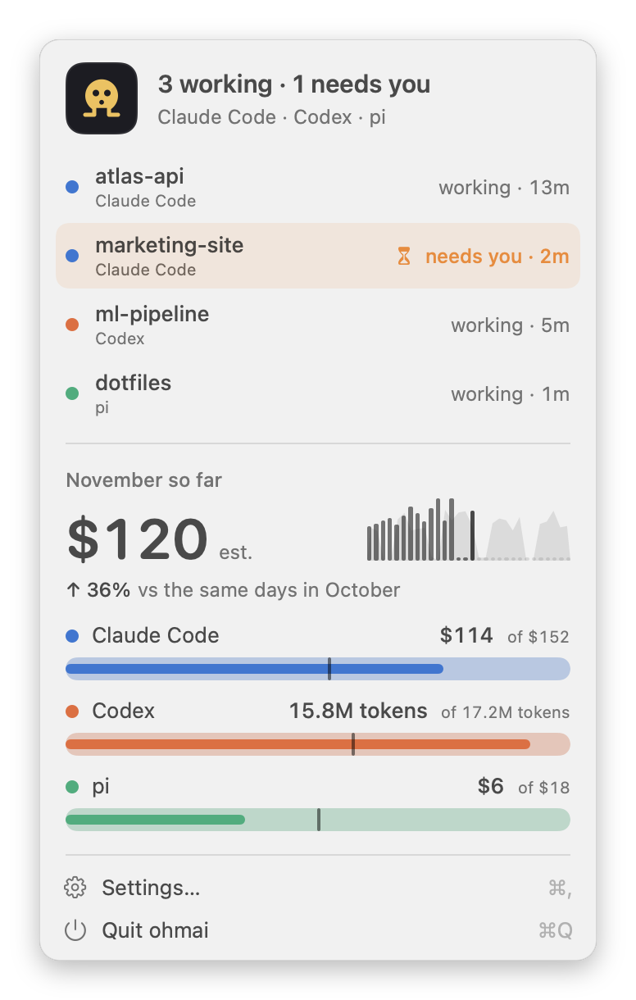
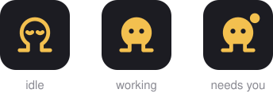

  

<h1 align="center">ohmai</h1>

  Your AI coding agents and what they cost, at a glance, from the menu bar. 
  For Claude Code, Codex and pi.

  <a href="https://github.com/nicwestvold/ohmai/releases/latest"><b>Download</b></a> ·
  <a href="docs/install.md">Install guide</a> ·
  macOS 26+

  <picture>
    <source media="(prefers-color-scheme: dark)" srcset="docs/images/menu-dark.png">
    
  </picture>

- **See every agent.** Which sessions are working, which need you, and for how long.
- **Know what you're spending.** Tokens and estimated cost per agent this month, against the same days last month.
- **Nothing leaves your Mac.** ohmai makes no network requests, and reads only usage numbers, never what you or the agents wrote.

  

The name is "oh my ai", with a nod to the ohm (Ω), which is also its face.

## Get started

Download the disk image from [Releases](https://github.com/nicwestvold/ohmai/releases/latest), drag ohmai to Applications, and open it. Claude Code and Codex work with no setup; for pi, install the extension from Settings → Agents.

## Learn more

- [Install, update and uninstall](docs/install.md), plus privacy details and how each agent is read
- [Keeping the Mac awake](docs/keep-awake.md) while agents work (optional, off by default)
- [Building from source](docs/building.md)

## License

MIT. See [LICENSE](LICENSE).
